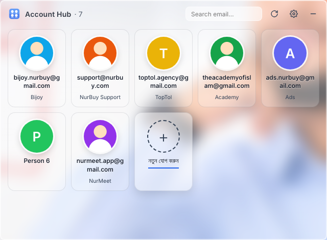

# Account Hub (EmailHub)

A Windows desktop app that shows every email/profile signed in to Chrome (and optionally Edge / Brave) as a tile with its profile picture. Clicking a tile opens the browser directly in that profile.



## Features
- Auto-detects browser profiles from `Local State` (no login needed inside the app); updates live when a new account is added
- Profile picture + email (or name) under each tile, search box, hide/unhide profiles
- "+" tile opens a fresh browser profile to sign in a new email
- Frameless desktop widget with real glass blur (Windows accent policy: Acrylic / Blur / Clear) and adjustable tint
- Light / dark mode, always-on-top, start with Windows, tray icon, remembers position
- Chrome, Edge, Brave supported; custom browser `.exe` path per browser

## Project layout
```
src/main.js      Electron main process: profile discovery, launching, glass, tray, settings
src/preload.js   Safe bridge between UI and main process
src/index.html   UI (grid + settings), plain HTML/CSS/JS
build/           App icon + afterPack hook (sets .exe icon via rcedit)
```

## Run & build
```bash
npm install
npm start          # run in development
npm run dist       # build Windows installer -> dist/Account Hub Setup x.y.z.exe
```
Building the installer on Linux needs Wine (64- and 32-bit): `apt install wine64 wine32:i386`.
Use `npx electron-builder --win nsis --x64 --publish never`.

Settings are stored in `%APPDATA%\Account Hub\config.json`.
